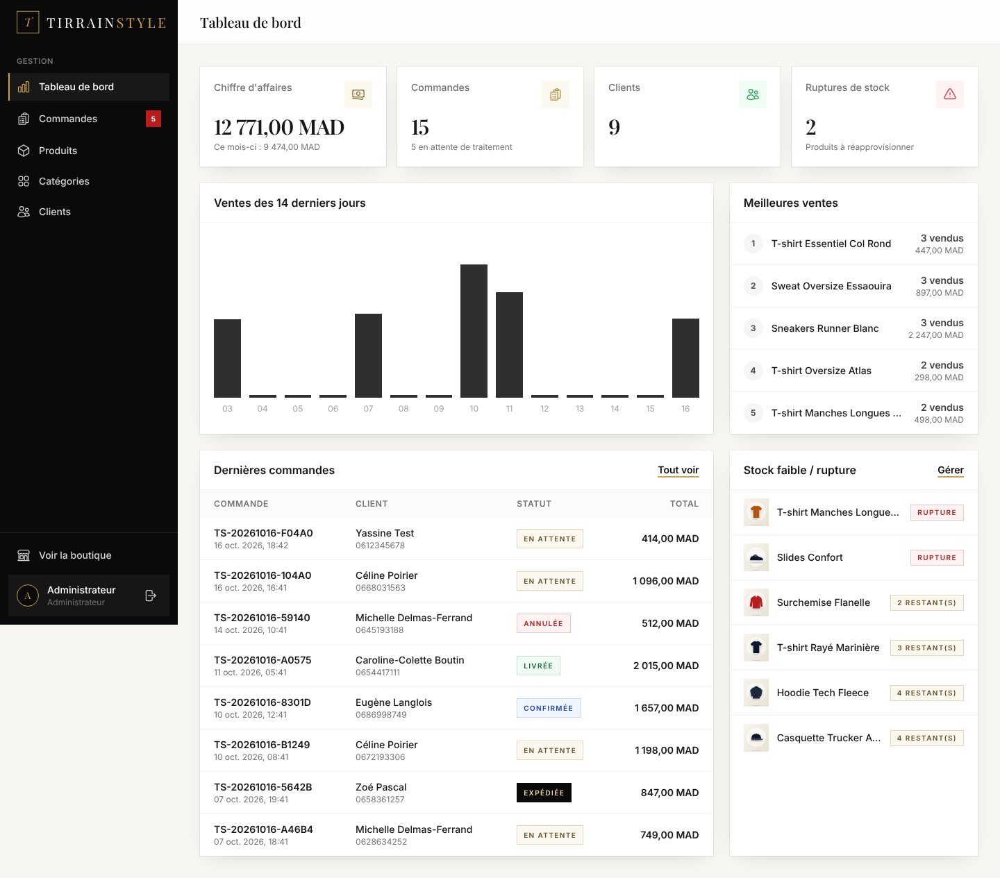

# TirrainStyle — Boutique e-commerce Laravel

Boutique en ligne de mode streetwear pour le marché marocain : prix en dirhams (format « 1 299,00 MAD »), paiement à la livraison et interface entièrement en français.

**Stack :** Laravel 13 · PHP 8.2+ · Blade · Tailwind CSS 3 · Alpine.js · Vite · SQLite (MySQL possible) · Laravel Breeze

| Accueil | Back-office |
|---|---|
|  |  |

Les autres captures sont dans [`docs/captures`](docs/captures) : catalogue, fiche produit, panier, commande et mobile.

---

## Fonctionnalités

### Boutique (côté client)
- **Accueil** : hero avec appel à l'action, avantages (livraison, paiement à la livraison, retours), catégories en vedette, produits populaires, bannière promo, nouveautés, newsletter.
- **Catalogue** (`/boutique`) : grille paginée, filtres par catégorie, prix min/max et promotions, tri (nouveautés, prix, nom), recherche par nom, filtres actifs supprimables.
- **Fiche produit** : galerie avec miniatures et zoom plein écran, prix barré en cas de promo, indicateur de stock, sélecteur de quantité, ajout au panier en AJAX avec notification, produits similaires.
- **Panier en session** : modification des quantités, suppression, sous-total, frais de livraison (gratuits au-delà d'un seuil) et barre de progression.
- **Commande** : formulaire (nom, téléphone marocain, e-mail, ville, adresse), paiement à la livraison, page de confirmation avec numéro de commande (`TS-AAAAMMJJ-XXXXX`).
- **E-mails automatiques** : confirmation envoyée au client dès la validation, e-mail à chaque changement de statut (confirmée, expédiée, livrée, annulée), alerte optionnelle à la boutique.
- **Suivi de commande** (`/suivi-commande`) : sans compte, avec le numéro de commande et le téléphone, ou en un clic grâce au lien sécurisé (signé) présent dans les e-mails.
- **Espace client** : inscription, connexion, tableau de bord, historique des commandes avec frise de suivi, profil.
- **Pages statiques** : À propos, Contact (formulaire validé avec protection anti-spam), FAQ, CGV, pages d'erreur 403, 404, 419 et 500.

### Back-office (`/admin`, rôle admin uniquement)
- **Tableau de bord** : chiffre d'affaires, commandes, clients, ruptures, graphique des ventes sur 14 jours, meilleures ventes, dernières commandes, stocks faibles.
- **Produits** : CRUD complet, plusieurs images avec aperçu, prix et prix promo, stock, catégorie, actif/inactif, mise en avant, recherche et filtres.
- **Catégories** : CRUD avec image, position et mise en vedette.
- **Commandes** : liste filtrable (statut, recherche, dates), détail, changement de statut (en attente, confirmée, expédiée, livrée, annulée). Une annulation remet le stock.
- **Clients** : liste avec nombre de commandes et total dépensé.

---

## Installation

Prérequis : PHP 8.2+ (extensions `pdo_sqlite`, `mbstring`, `fileinfo`), Composer 2, Node.js 18+ et npm.

```bash
git clone <url-du-depot> tirrainstyle && cd tirrainstyle

composer install
npm install

cp .env.example .env
php artisan key:generate

# Base SQLite + données de démonstration (admin, 6 catégories, 30 produits, commandes)
touch database/database.sqlite
php artisan migrate --seed

# Lien public vers storage/app/public (images produits)
php artisan storage:link
```

## Lancement

Dans deux terminaux :

```bash
php artisan serve      # http://127.0.0.1:8000
npm run dev            # Vite (rechargement à chaud)
```

Pour la production, utilisez `npm run build` à la place de `npm run dev`.

### Comptes de démonstration

| Rôle  | E-mail               | Mot de passe |
|-------|----------------------|--------------|
| Admin | `admin@boutique.ma`  | `password`   |
| Client| `client@boutique.ma` | `password`   |

Pour réinitialiser les données : `php artisan migrate:fresh --seed`. Les images placeholder (SVG) sont régénérées à chaque fois.

### Tests

```bash
php artisan test
```

59 tests couvrent : panier, prix recalculés côté serveur, transaction de commande et stock, accès privé aux commandes, contrôle d'accès admin, CRUD, upload d'images, e-mails de commande (envoi après validation, aucun envoi si la commande échoue, erreur SMTP, anti-doublon, relance), suivi de commande, formulaires de contact et de newsletter, authentification Breeze.

---

## E-mails (confirmation et suivi de commande)

### Fonctionnement
1. Le client valide sa commande : `OrderService::place()` l'enregistre dans une transaction (prix recalculés, stock décrémenté).
2. **Seulement après** l'enregistrement réussi, `OrderNotifier::sendConfirmation()` envoie l'e-mail `OrderConfirmed` (HTML responsive + version texte) à l'adresse saisie et validée au checkout.
3. **Anti-doublon** : la colonne `orders.confirmation_sent_at` est réservée de façon atomique avant l'envoi. Une même commande ne reçoit donc jamais deux confirmations (double clic, relances simultanées…).
4. **Échec d'envoi** (SMTP indisponible, identifiants erronés…) : la commande est conservée, l'erreur est journalisée dans `storage/logs/laravel.log` avec le numéro de commande, et `confirmation_sent_at` reste vide pour permettre une nouvelle tentative.
5. **Nouvelle tentative**, sans jamais recréer de commande :
   - automatique toutes les 15 minutes via le planificateur (`php artisan schedule:work` en local, cron `* * * * * php artisan schedule:run` en production) ;
   - en ligne de commande : `php artisan orders:send-confirmations` (ou `php artisan orders:send-confirmations TS-XXXXXXXX-XXXXX` pour une commande) ;
   - depuis le back-office : fiche commande › « Renvoyer la confirmation ».

Contenu de l'e-mail : objet « Confirmation de votre commande n° … », nom du client, numéro, date et statut de la commande, produits (nom, quantité, prix), sous-total, livraison, total, adresse de livraison, mode de paiement, bouton de suivi, remerciements et coordonnées du service client (`config/shop.php`). Les modèles sont dans `resources/views/emails/`.

### Configuration (`.env` uniquement, jamais dans Git)

Par défaut (`MAIL_MAILER=log`), aucun e-mail ne part : le message complet est écrit dans `storage/logs/laravel.log`.

**Brevo** (gratuit jusqu'à 300 e-mails/jour) : créez un compte, puis *SMTP & API › Clés SMTP* :
```dotenv
MAIL_MAILER=smtp
MAIL_HOST=smtp-relay.brevo.com
MAIL_PORT=587
MAIL_USERNAME=votre-identifiant@smtp-brevo.com
MAIL_PASSWORD=votre-cle-smtp-brevo
MAIL_FROM_ADDRESS="contact@votre-domaine.ma"   # adresse vérifiée dans Brevo
MAIL_FROM_NAME="TirrainStyle"
```

**Gmail** : activez la validation en deux étapes, puis créez un *mot de passe d'application* (Compte Google › Sécurité) :
```dotenv
MAIL_MAILER=smtp
MAIL_HOST=smtp.gmail.com
MAIL_PORT=587
MAIL_USERNAME=votre.adresse@gmail.com
MAIL_PASSWORD="xxxx xxxx xxxx xxxx"
MAIL_FROM_ADDRESS="votre.adresse@gmail.com"
MAIL_FROM_NAME="TirrainStyle"
```

Facultatif : `SHOP_ADMIN_EMAIL=...` pour recevoir une alerte à chaque nouvelle commande.

Après toute modification de `.env` : `php artisan config:clear`.

### Tester un envoi réel
1. Configurez `.env` comme ci-dessus, puis `php artisan config:clear`.
2. Lancez `php artisan serve`, ajoutez un produit au panier et validez une commande **avec votre propre adresse e-mail**.
3. Vérifiez votre boîte de réception (et les spams). La page de confirmation indique l'adresse utilisée.
4. En cas de problème, consultez la fin de `storage/logs/laravel.log` (message « Échec de l'envoi de la confirmation de commande » avec l'erreur SMTP), corrigez `.env`, puis relancez : `php artisan orders:send-confirmations`.

| Événement | E-mail |
|---|---|
| Commande enregistrée | Confirmation au client (une seule fois) + alerte à `SHOP_ADMIN_EMAIL` si renseignée |
| Changement de statut par l'admin | Information au client (case « Prévenir le client par e-mail ») |

## Passer à MySQL

Dans `.env` :

```dotenv
DB_CONNECTION=mysql
DB_HOST=127.0.0.1
DB_PORT=3306
DB_DATABASE=tirrainstyle
DB_USERNAME=root
DB_PASSWORD=
```

Puis lancez `php artisan migrate --seed`. Avec MySQL, le verrouillage `lockForUpdate()` de la commande devient pleinement effectif.

## Configuration de la boutique

`config/shop.php` contient les frais de livraison, le seuil de gratuité, la quantité maximale par article, la durée pendant laquelle un produit reste « Nouveau », le seuil de stock faible, les coordonnées et la liste des villes. Les frais sont aussi réglables dans `.env` :

```dotenv
SHOP_SHIPPING_FEE=35
SHOP_FREE_SHIPPING_THRESHOLD=500
```

---

## Architecture

```
app/
├── Enums/                 OrderStatus, PaymentMethod, PaymentStatus (libellés FR + couleurs)
├── Http/
│   ├── Controllers/       Contrôleurs fins (boutique, Account/, Admin/)
│   ├── Middleware/        EnsureUserIsAdmin (alias « admin »)
│   └── Requests/          Validation (Checkout, Contact, Admin/Product…)
├── Mail/                  OrderConfirmed, OrderStatusUpdated, NewOrderAdmin
├── Models/                User, Category, Product, ProductImage, Order, OrderItem…
├── Services/
│   ├── Cart/CartService   Panier en session (ids + quantités uniquement)
│   ├── OrderService       Création de commande en transaction + gestion du stock
│   ├── OrderNotifier      Envoi des e-mails de commande (sans jamais bloquer la commande)
│   └── Payment/           PaymentGateway, CashOnDeliveryGateway, PaymentManager
├── Support/PlaceholderImage  Génération des visuels SVG de démo
└── helpers.php            format_mad()
resources/views/
├── components/            button, product-card, badge, alert, modal, input, select,
│                          textarea, price, icon, breadcrumbs, confirm-delete, admin/*
├── layouts/               app (boutique), admin (dashboard), guest (authentification)
└── home, products, cart, checkout, account, pages, admin, errors
```

### Sécurité
- **Prix toujours recalculés côté serveur** : la session ne stocke que `product_id => quantité`, et les prix et stocks sont relus en base à chaque affichage et à la commande.
- **Transaction de commande** : produits verrouillés (`lockForUpdate`), vérification du stock, décrément, puis création de la commande. En cas d'échec, rien n'est enregistré.
- Protection CSRF sur tous les formulaires, validation par Form Requests, limitation de débit sur le checkout, le contact et la newsletter.
- Accès admin via la Gate `access-admin` et le middleware `admin`. Le champ `role` n'est pas assignable en masse.
- Confirmation de commande et détail visibles uniquement par leur auteur (session ou compte).

### Ajouter Stripe plus tard
1. `composer require stripe/stripe-php`
2. Ajouter `case Stripe = 'stripe';` dans `App\Enums\PaymentMethod`.
3. Créer `App\Services\Payment\StripeGateway` qui implémente `PaymentGateway` : créer une Checkout Session puis retourner `new PaymentResult(redirectUrl: $session->url)`.
4. L'enregistrer dans `PaymentManager::$gateways`.
5. Ajouter une route de webhook qui passe `payment_status` à `paid`.

Le checkout gère déjà la redirection vers une passerelle externe.
